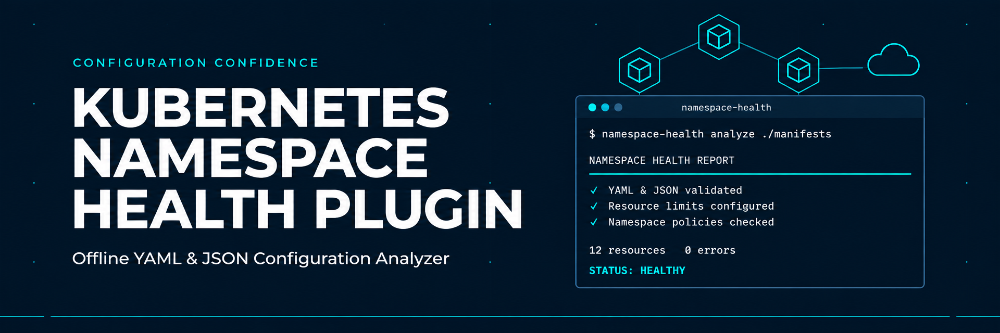
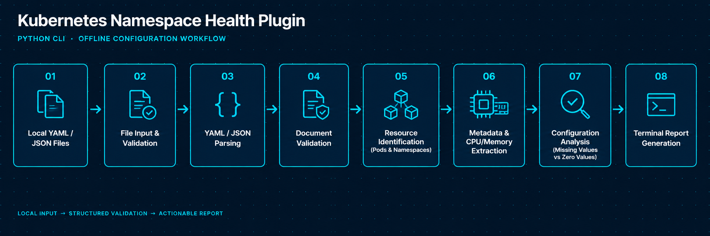
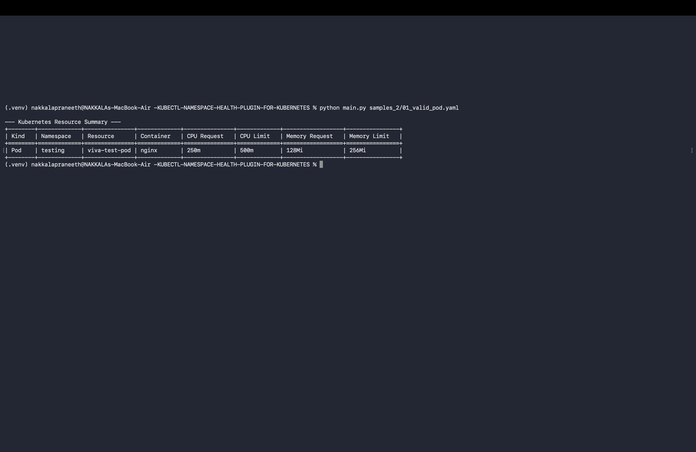

# Kubernetes Namespace Health Plugin

## Project Overview

Kubernetes Namespace Health Plugin is a lightweight Python-based CLI tool that analyzes local Kubernetes YAML and JSON configuration files.

It identifies Pods and Namespaces, extracts CPU and memory resource requests and limits, and highlights missing or explicitly zero resource configurations.

The tool helps developers identify potential configuration issues through a structured terminal report without manually inspecting every manifest.

**Note:** This tool analyzes local configuration files only. It does not connect to a live Kubernetes cluster.

## Key Features

- **YAML & JSON Support:** Analyzes Kubernetes configuration files in both formats.
- **Pod & Namespace Detection:** Identifies supported Kubernetes resources.
- **Resource Analysis:** Extracts CPU and memory requests and limits.
- **Missing Configuration Detection:** Identifies resource fields that are not configured.
- **Zero Value Detection:** Separately identifies explicitly configured zero values.
- **Multiple File Support:** Analyzes multiple configuration files.
- **Terminal Report:** Displays results in a structured and readable table.
- **Error Handling:** Handles missing files, invalid configurations, and parsing errors.
- **Offline Analysis:** Works with local configuration files without requiring cluster access.

## Technology Stack

| Technology | Purpose |
|---|---|
| Python 3 | Core programming language |
| PyYAML | YAML file parsing |
| JSON | JSON configuration parsing |
| Argparse | Command-line argument handling |
| Tabulate | Structured terminal tables |
| Dataclasses | Structured data representation |
| Git & GitHub | Version control and collaboration |
| Unittest | Automated testing |
| Coverage.py | Test coverage measurement |

## Project Architecture

The following diagram illustrates the workflow used by the Kubernetes Namespace Health Plugin, from local configuration file input to terminal report generation.



## Installation

### Prerequisites

Make sure you have the following installed:

- Python 3
- Git

### 1. Clone the repository

```bash
git clone https://github.com/praneeth0209/-KUBECTL-NAMESPACE-HEALTH-PLUGIN-FOR-KUBERNETES.git

## Usage

The tool accepts one or more local Kubernetes YAML or JSON files as command-line arguments.

### Analyze a YAML file

```bash
python main.py samples/01_valid_pod.yaml

python main.py samples/your-file.json

python main.py --help
```


*Note: The JSON filename is an example. Replace it with an actual JSON sample file in your repository.*


## Sample Output

The tool generates a structured terminal report containing Kubernetes resource information and CPU/memory configurations.



The report includes:

- Resource kind
- Namespace
- Resource name
- Container name
- CPU requests and limits
- Memory requests and limits

Missing configurations are displayed as `[NONE]`, while explicitly configured zero values are displayed as `0`.


## Testing
The project uses Python's unittest framework for automated testing.

Run the test suite using:

```bash
python -m unittest discover -s tests
```
```bash
python -m coverage run -m unittest discover -s tests
python -m coverage report -m --include="main.py"
```


## Step 11 — Project Scope

## Project Scope

### Included
- Local Kubernetes YAML and JSON file analysis.
- Pod and Namespace identification.
- CPU and memory resource extraction.
- Missing and zero-value configuration detection.
- Structured terminal reporting.

### Not Included
- Live Kubernetes cluster connection.
- Real-time monitoring.
- Modifying Kubernetes configuration files.
- Deploying or managing Kubernetes resources.


## Future Improvements

- Support additional Kubernetes resource types.
- Improve report customization.
- Add more configuration validation rules.
- Enhance automated testing and reporting.